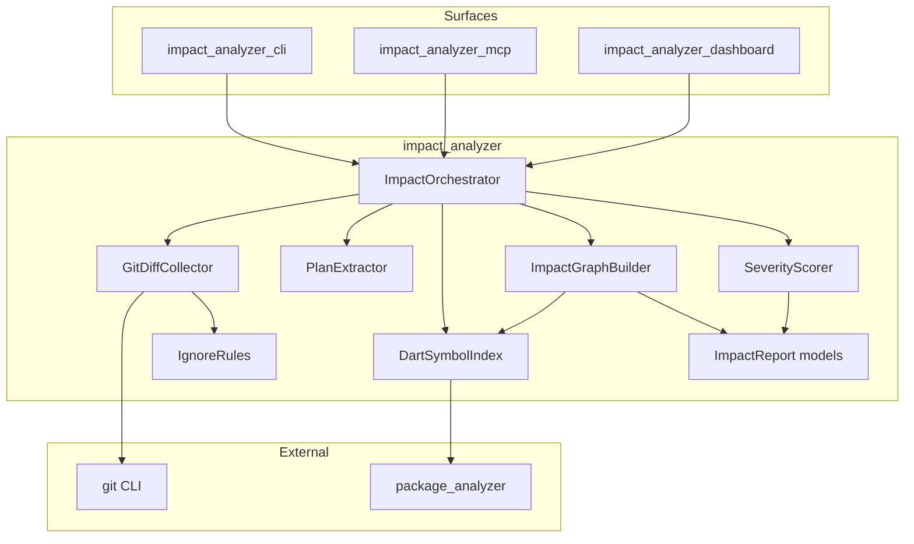
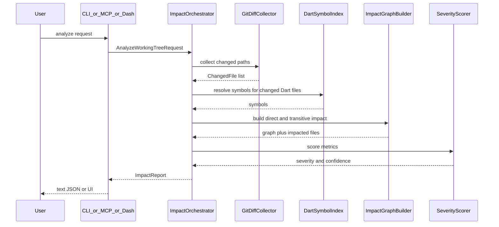

# Architecture — Impact Analyzer (Dart Only)

## 1. Monorepo layout

```
impact-analyzer/
  docs/                          # product & technical docs
  fixtures/
    sample_app/                  # Dart/Flutter fixture, generated by
                                 # tools/bootstrap_fixture.ps1 — see FIXTURE.md
  packages/
    impact_analyzer/             # core library
    impact_analyzer_cli/         # CLI executable
    impact_analyzer_mcp/         # MCP stdio server
    impact_analyzer_dashboard/   # local HTTP UI + API
  README.md
  pubspec.yaml                   # workspace root (planned)
```

## 2. Component diagram



## 3. Pipeline



## 4. Core modules

| Module | Responsibility |
|---|---|
| `GitDiffCollector` | Working tree / staged / range path collection |
| `IgnoreRules` | Built-in + `.impactignore` + `impact.yaml` |
| `PlanExtractor` | Markdown/JSON → candidate files/symbols |
| `DartSymbolIndex` | Analyzer contexts, element lookup |
| `ImpactGraphBuilder` | Import/reference expansion |
| `SeverityScorer` | Metrics → score/band/rationale |
| `ImpactOrchestrator` | Wire pipeline; produce `ImpactReport` |

## 5. Data flow rules

1. Surfaces never reimplement scoring.
2. Reports are immutable value objects / freezed-style models.
3. Analyzer failures surface as structured errors; partial graphs may still return with lowered confidence.
4. Cache keys include: package config hash, changed file set, config hash, analyzer SDK version.

## 6. Dashboard deployment model

- Process: `impact serve` starts HTTP server on `127.0.0.1`
- API returns `ImpactReport` JSON
- UI renders tables + graph client-side
- Optional watch: poll git status or FS events (phase 4+)

## 7. MCP process model

- Long-lived stdio process
- One tool call → one analysis (or cached)
- No shared mutable global state across repos without explicit `rootPath`

## 8. Testing strategy

| Layer | What |
|---|---|
| Unit | Scorer, ignore, plan extractor |
| Integration | Fixture repo with known diffs → golden `ImpactReport` |
| MCP | Golden tool envelopes |
| Dashboard | API contract tests; manual UX checklist |

## 9. Extension points (later)

- Alternate graph backends
- CI reporter (GitHub annotation formatter)
- Plugin weights for Riverpod/Bloc detection
